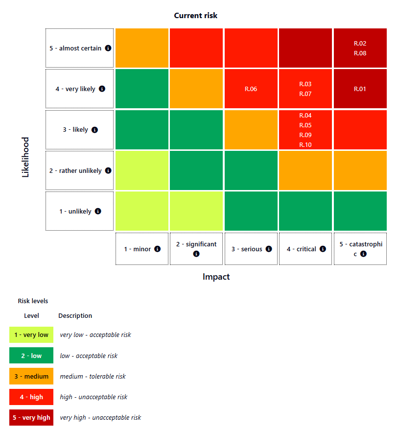

# NoorPay GRC Consulting Engagement

**Risk assessment, compliance gap analysis and incident response plan for a Saudi fintech (case study)**

`NIST SP 800-30` · `ISO 27005` · `GDPR` · `Saudi PDPL` · `NIST SP 800-61` · `CISO Assistant`

> **Note:** NoorPay is a fictional company from a course scenario (CS 3178, Governance, Risk and Compliance, Effat University, Spring 2026). No real company or customer data is involved.

## Overview

NoorPay is a Saudi payment company processing **500,000+ transactions a day** for Saudi and EU customers. It has no CISO, no risk register, no cloud security policy and no incident response plan. A 2024 breach exposed **12,000 customer records** and was never reported to regulators.

Acting as external GRC consultants, we:

1. **Assessed risk** using NIST SP 800-30 Rev. 1 and built a 10-risk register on a 5×5 likelihood × impact matrix.
2. **Ran a compliance gap analysis** against 12 requirements from GDPR and Saudi PDPL.
3. **Wrote an Incident Response Plan** based on NIST SP 800-61 Rev. 2.
4. **Gave management a remediation roadmap**, ordered by risk.

All risks and compliance audits were captured in [CISO Assistant](https://github.com/intuitem/ciso-assistant-community), an open-source GRC platform. The Saudi PDPL framework was built as a custom YAML library from SDAIA's official guidance.

📄 **[Read the full report (PDF)](report/NoorPay_GRC_Engaement.pdf)** **

## Key findings

| Area | Result |
|---|---|
| Risk register | 10 risks: **2 Critical**, 3 High, 5 Medium |
| Top risks | R-02 Repeat data breach (25/25), R-08 Regulatory audit failure (25/25), R-01 Unauthorized cloud access (20/25) |
| GDPR (6 articles) | **6 / 6 Non-Compliant** |
| Saudi PDPL (6 articles) | **6 / 6 Non-Compliant** |
| Most critical gap | Unreported 2024 breach: a confirmed violation of GDPR Art. 33 and PDPL Art. 20 |

## Recommendations to management

| Priority | Action | Addresses |
|---|---|---|
| Urgent (0–1 month) | Submit a retroactive breach notification to SDAIA and the lead EU supervisory authority | GDPR Art. 33, PDPL Art. 20, R-02, R-08 |
| Immediate (0–1 month) | Build a Records of Processing Activities (RoPA) register with the lawful basis for each activity | GDPR Art. 6 & 30, PDPL Art. 5 |
| Immediate (0–1 month) | Appoint an interim Data Protection Officer | GDPR Art. 37 |
| Immediate (0–1 month) | Enforce MFA on all cloud and internal accounts | GDPR Art. 32, PDPL Art. 15, R-01, R-07 |
| Short-term (1–3 months) | Publish a Cloud Security Policy with a named owner | GDPR Art. 32, PDPL Art. 15, R-04 |

## Repository contents

| Folder | What's inside |
|---|---|
| [`report/`](report/) | The full engagement report (PDF) |
| [`risk-assessment/`](risk-assessment/) | Methodology, top risks and the [risk register (CSV)](risk-assessment/risk_register.csv) |
| [`compliance-gap-analysis/`](compliance-gap-analysis/) | GDPR and PDPL gap analysis, critical gaps and the [gap table (CSV)](compliance-gap-analysis/gap_analysis.csv) |
| [`incident-response/`](incident-response/) | The Incident Response Plan in Markdown |
| [`screenshots/`](screenshots/) | CISO Assistant screenshots of the risk assessment and both compliance audits |

## Skills demonstrated

- Risk identification, scoring and prioritization (NIST SP 800-30, ISO 27005)
- Regulatory gap analysis and evidence-based compliance findings (GDPR, Saudi PDPL)
- Building a custom compliance framework in a GRC tool (YAML)
- Incident response planning, severity classification and regulator notification workflows (NIST SP 800-61)
- Writing remediation recommendations for a management audience

## Authors

- **Zainab Taha**: [LinkedIn](https://linkedin.com/in/zainab-taha-cs) · [GitHub](https://github.com/zainabthaa)
- **Natali Soukh**

Supervised by Dr. Sohail Khan, Effat University.

## References

1. NIST SP 800-30 Rev. 1, *Guide for Conducting Risk Assessments* (2012). https://doi.org/10.6028/NIST.SP.800-30r1
2. NIST SP 800-61 Rev. 2, *Computer Security Incident Handling Guide* (2012). https://doi.org/10.6028/NIST.SP.800-61r2
3. Regulation (EU) 2016/679 (GDPR). https://eur-lex.europa.eu/legal-content/EN/TXT/?uri=CELEX:32016R0679
4. Saudi Personal Data Protection Law, Royal Decree M/19 (2021), SDAIA.
5. CISO Assistant Community Edition, intuitem. https://github.com/intuitem/ciso-assistant-community
6. GDPR.EU, *GDPR checklist for data controllers*. https://gdpr.eu/checklist/
