# Compliance Gap Analysis

## Scope

| Regulation | Why it applies to NoorPay |
|---|---|
| **GDPR** (EU 2016/679) | Processes personal data of EU customers for international payments |
| **Saudi PDPL** (Royal Decree M/19, 2021) | Saudi company processing personal and financial data of Saudi residents; accountable to SDAIA |

Six provisions of each law were chosen based on how relevant they are to NoorPay's operations. The audits were done in CISO Assistant: GDPR used the GDPR.EU controller checklist, and Saudi PDPL used a **custom framework written as a YAML library** from SDAIA's official guidance.

## Results: 12 / 12 Non-Compliant

Full data: [`gap_analysis.csv`](gap_analysis.csv)

| Regulation | Requirement | Gap |
|---|---|---|
| GDPR | Art. 6: Lawful basis | No documented legal justification for any EU processing |
| GDPR | Art. 25: Privacy by design | No DPIAs, no privacy controls, no data minimization defaults |
| GDPR | Art. 30: Records of processing | No data inventory, processing register or retention schedule |
| GDPR | Art. 32: Security of processing | No documented technical or organizational controls |
| GDPR | Art. 33: Breach notification | 2024 breach never reported; 72-hour window missed |
| GDPR | Art. 37: DPO | No DPO despite large-scale financial data processing |
| PDPL | Art. 5: Lawful basis and consent | No consent or contract-basis records |
| PDPL | Art. 9: Data minimization | Data collected never assessed against minimum necessary |
| PDPL | Art. 12: Data subject rights | No request portal, contact or procedure for 500,000+ customers |
| PDPL | Art. 15: Security measures | No security policy, no CISO, cloud security undocumented |
| PDPL | Art. 20: Breach notification to SDAIA | 2024 breach never reported to SDAIA |
| PDPL | Art. 30: Cross-border transfer | Cloud data location unknown; possible transfer outside KSA without safeguards |

## Three most critical gaps

| # | Gap | Recommendation | Priority |
|---|---|---|---|
| 1 | Unreported breach (GDPR Art. 33 + PDPL Art. 20) | Retroactive notification to SDAIA and the lead EU authority, covering breach type, 12,000 records, data categories, consequences and remediation | Urgent, 0–1 month |
| 2 | No documented lawful basis (GDPR Art. 6 + PDPL Art. 5) | Compliance Officer builds a RoPA in 30 days: lawful basis, data categories, retention and third-party sharing for each activity | Immediate, 0–1 month |
| 3 | No security measures (GDPR Art. 32 + PDPL Art. 15) | Enforce MFA on all cloud and internal accounts, then a one-page Cloud Security Policy owned by the IT Manager | MFA 0–1 month; policy 1–3 months |

## CISO Assistant evidence

### GDPR
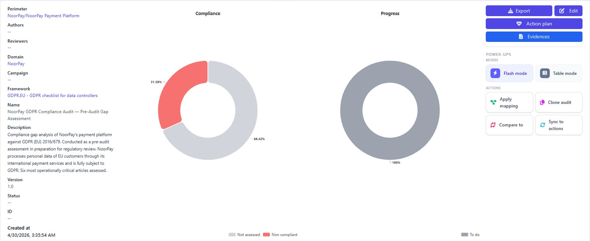
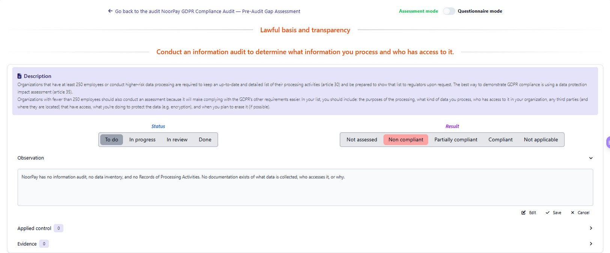
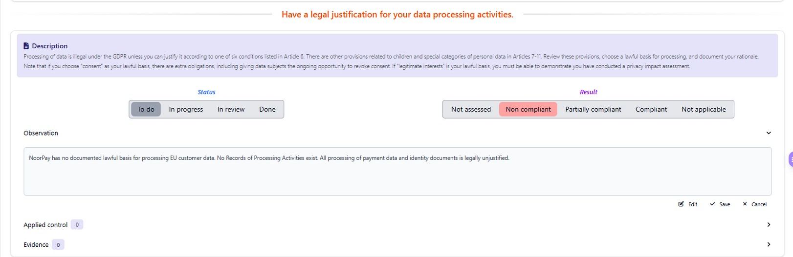
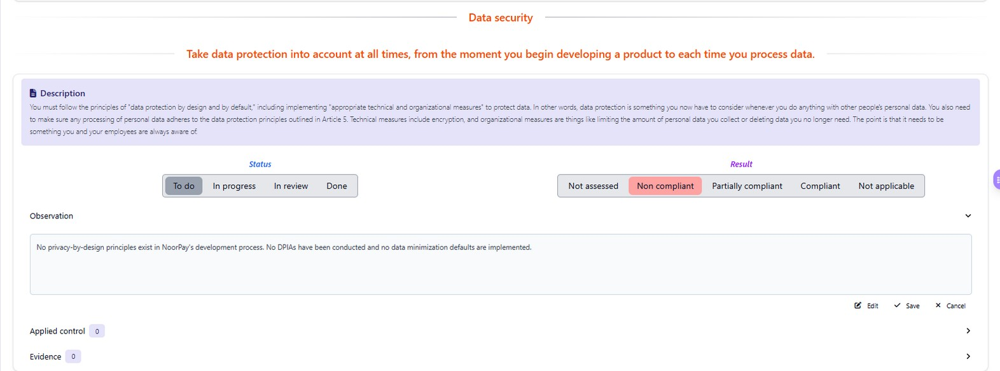
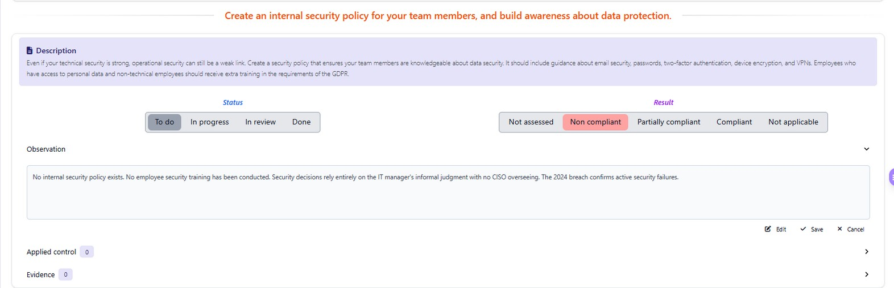
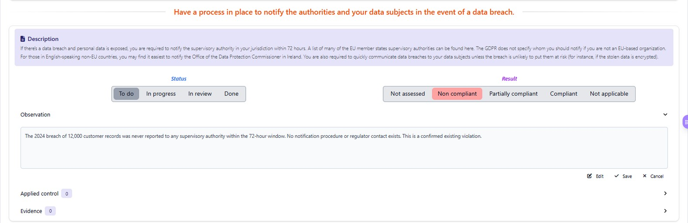
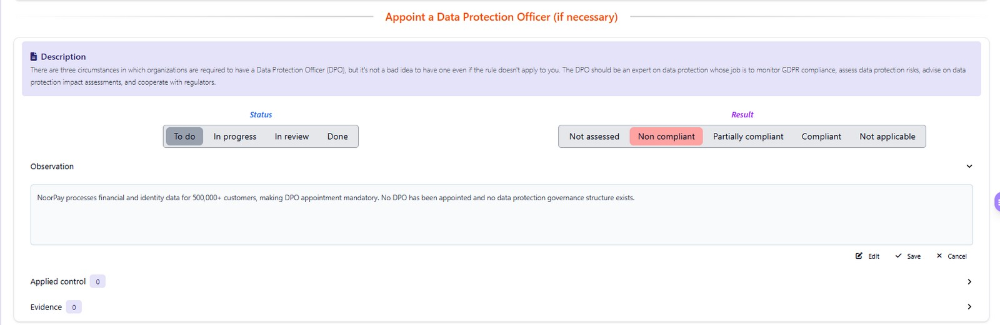

### Saudi PDPL
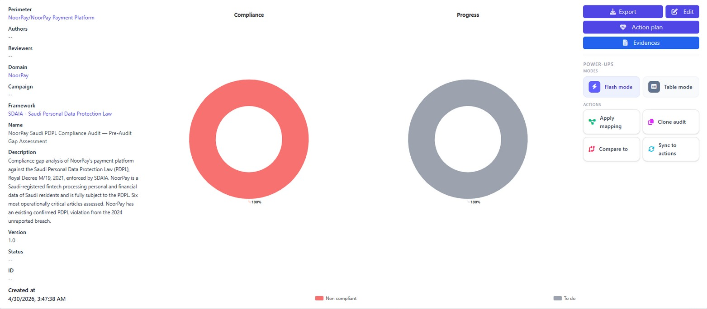
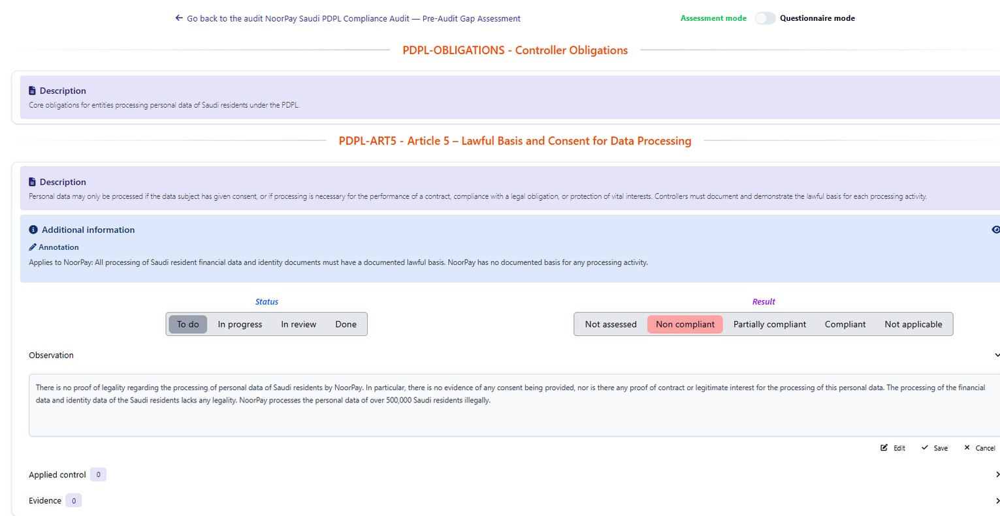
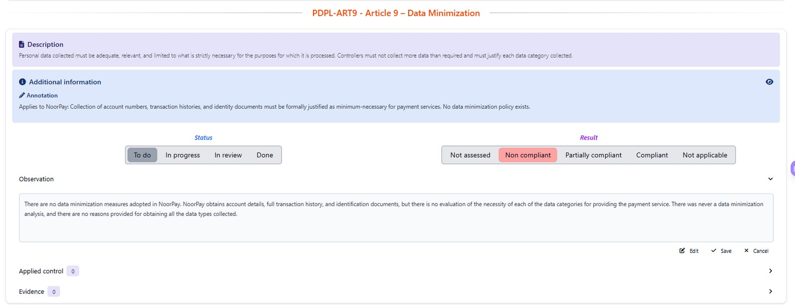
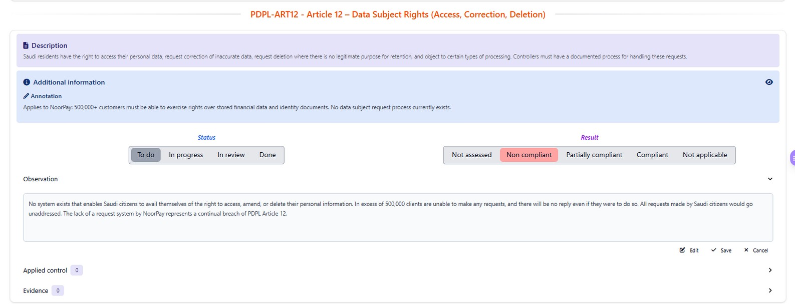
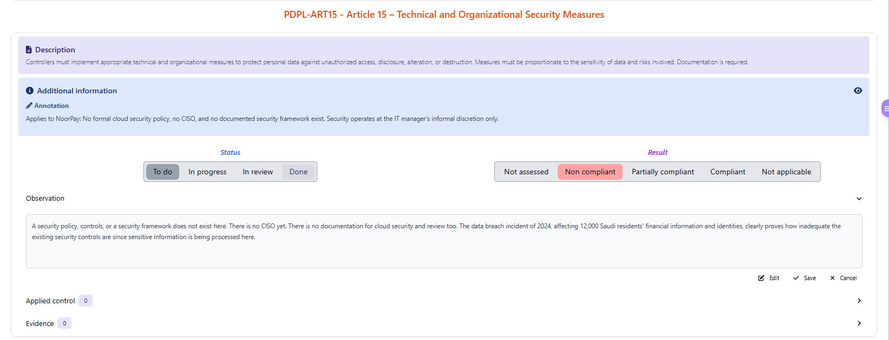
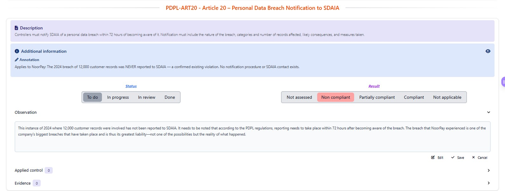
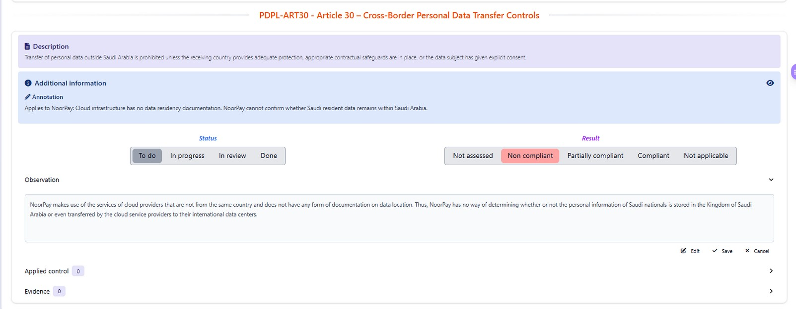
