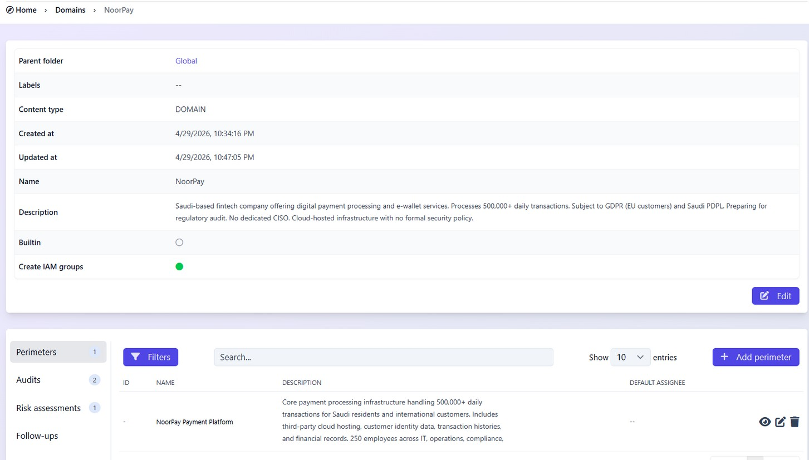
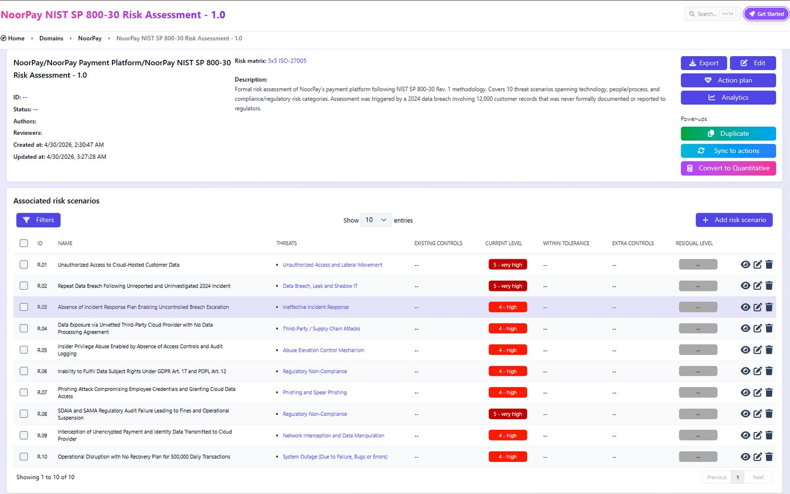

# Risk Assessment

## Methodology

- **Framework:** NIST SP 800-30 Rev. 1
- **Scoring:** Likelihood (1–5) × Impact (1–5), each with a written justification
- **Rating bands:** Low 1–8 · Medium 9–14 · High 15–25. Risks scoring 25 are flagged **Critical**.
- **Matrix:** 5×5 ISO 27005 matrix, generated in CISO Assistant
- **Categories:** Technology (R-01, R-04, R-07, R-09, R-10) · People/Process (R-03, R-05, R-06) · Compliance/Regulatory (R-02, R-08)

## Risk register

Full data: [`risk_register.csv`](risk_register.csv)

| ID | Risk | L | I | Rating | Level |
|---|---|---|---|---|---|
| R-02 | Repeat data breach following the unreported, uninvestigated 2024 incident | 5 | 5 | 25 | Critical |
| R-08 | SDAIA and SAMA audit failure due to zero documentation and the unreported breach | 5 | 5 | 25 | Critical |
| R-01 | Unauthorized access to cloud customer data via misconfiguration or stolen credentials | 4 | 5 | 20 | High |
| R-03 | No IRP, so any breach escalates without containment or notification | 4 | 4 | 16 | High |
| R-07 | Phishing compromises employee credentials and grants cloud data access | 4 | 4 | 16 | High |
| R-04 | Data exposure via an unvetted cloud provider with no DPA or data residency confirmation | 3 | 4 | 12 | Medium |
| R-05 | Insider privilege abuse due to no access controls or audit logging | 3 | 4 | 12 | Medium |
| R-06 | Inability to fulfill data subject rights (GDPR Art. 17, PDPL Art. 12) | 4 | 3 | 12 | Medium |
| R-09 | Interception of unencrypted payment and identity data in transit | 3 | 4 | 12 | Medium |
| R-10 | Operational disruption with no BCP/DRP for 500,000 daily transactions | 3 | 4 | 12 | Medium |

## Top three risks

**R-02: Repeat data breach (25/25, Critical).** The 2024 breach was never investigated, so the same weakness most likely still exists. A second breach on top of the unreported first one would bring penalties from several regulators at once.

**R-08: Regulatory audit failure (25/25, Critical).** An audit is coming and NoorPay has no compliance documentation to show. A suspension by the regulator would stop all operations.

**R-01: Unauthorized cloud access (20/25, High).** Cloud misconfiguration is the most common way attackers first get into fintech companies. With no cloud security policy and no monitoring, NoorPay would have no way to detect an attack.

## CISO Assistant evidence

